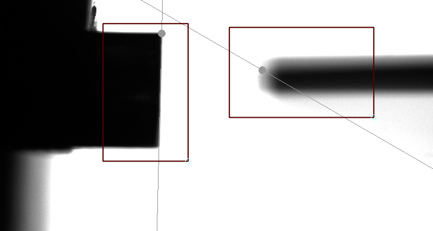
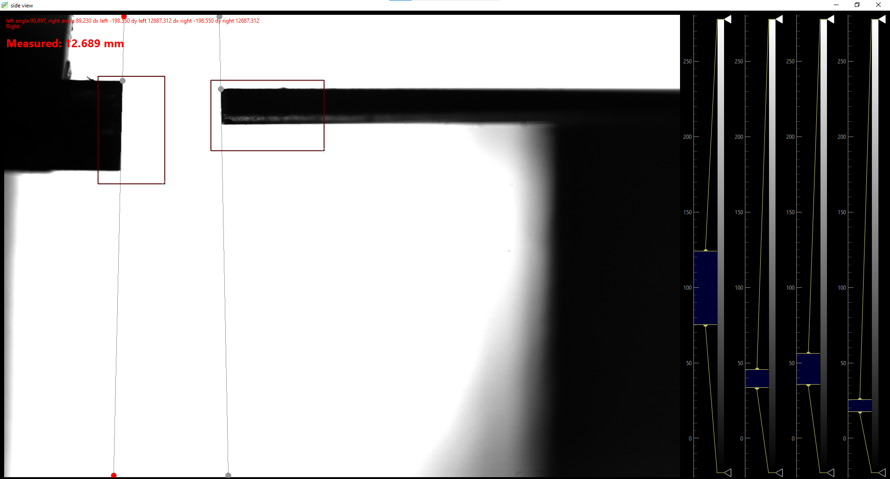
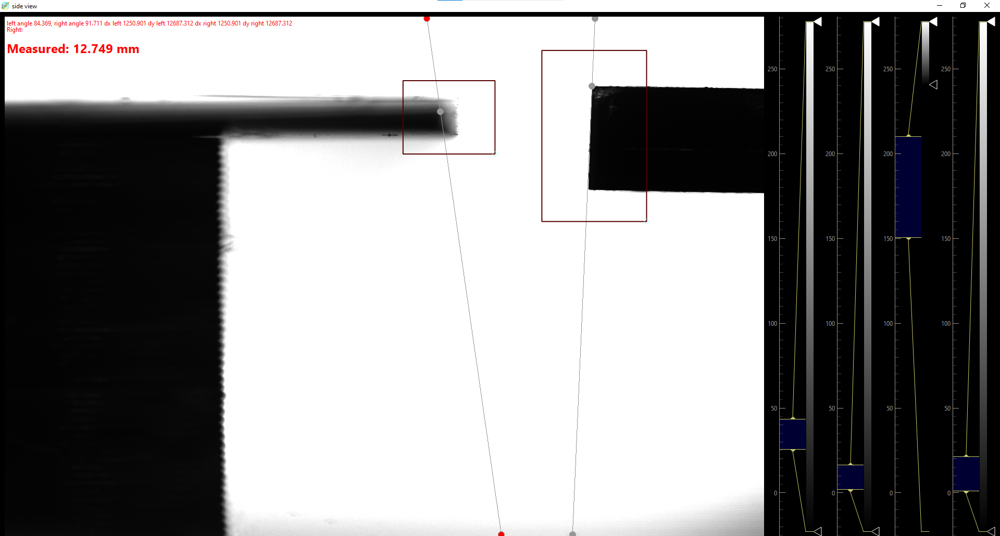
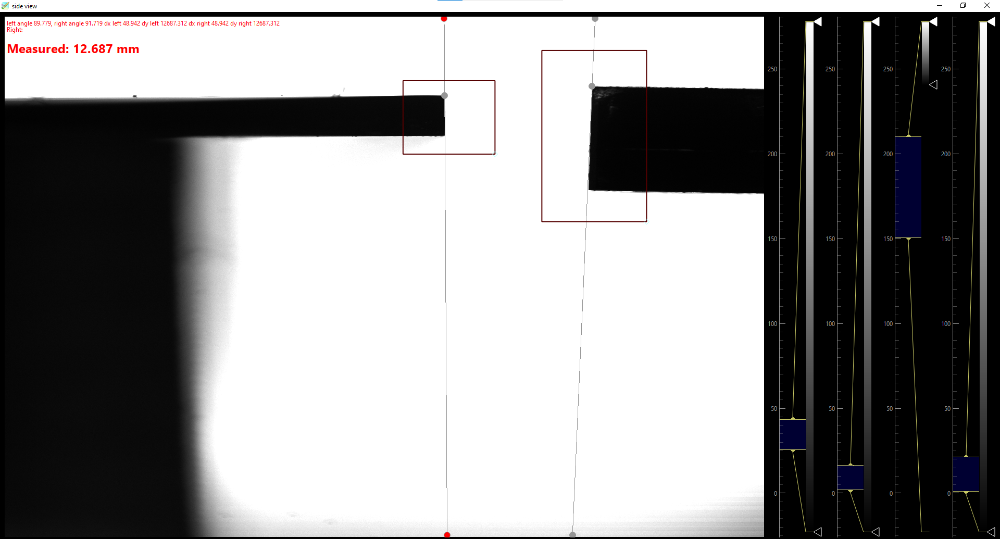
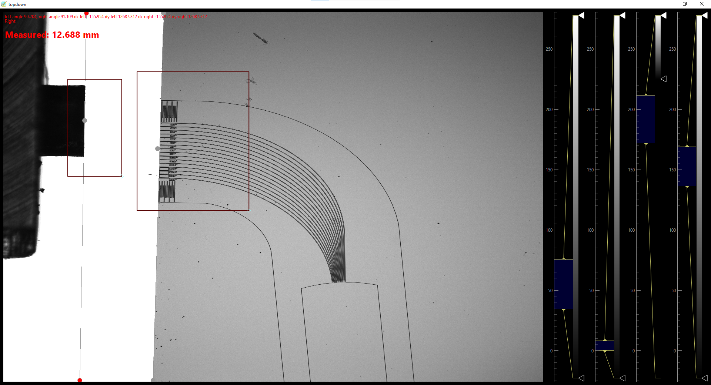
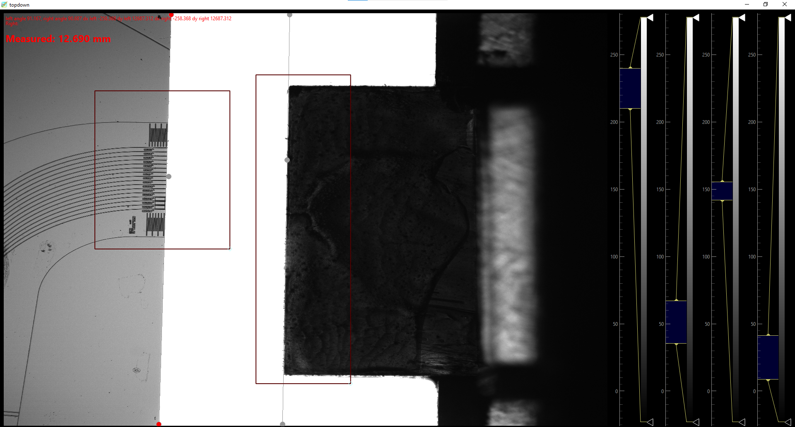

# Octopus
## Что это
Установка для экспресс-тестирования фотонных интегральных схем(ФИС) на полоске.

Используя машинное зрение, совмещаются входной и выходной FAB(Fiber Array Block) с ФИС, после чего измеряются характеристики ФИС. 
## Оборудование
- Измеритель мощности FIBERPRO Multichannel Optical Power Meter PM2100, 5 модулей CM1104
- Широкополосный лазер Golight Broadband Light Source (SLED) 
- Лазерный источник с перестраиваемой длиной волны Golight Laser Light Source (TUNE)
- Контроллер позиционеров WUHAN RED STAR YANG TECHNOLOGY CO., LTD PRECISION MOTION CONTROLLER OMT-22032508DK
- Контроллер позиционеров WUHAN RED STAR YANG TECHNOLOGY CO., LTD PRECISION MOTION CONTROLLER FBCU2A1
- Синхронизатор микроконтроллер LUATOS ...
- 2x Видеокамера ContrasTech Mars25MG-4gm
- VT-LT2-Pi2108W-3W
- ПК
- Подсветка Микромед 013694
## Инструкция
- Включить подсветки
- Поочередно включить оборудование с интервалом не менее 5 секунд, чтобы избежать резких перепадов напряжения
- Подождать 5 минут, пока прогреются приборы
- Включить компьютер
- Сдуть спринцовкой или сжатым воздухом загрязнения с установки
- протереть вакуумную оснастку(столик) безворсовой салфеткой
- Установить упор на магнитах сбоку от столика
- В чистых перчатках взять полоску с чипами
- Сдуть пыль сжатым воздухом или спринцовкой, протереть полоску с чипами безворсовой салфеткой
- Положить полоску с чипами рисунком вверх правильной стороной на столик, уперев в упор
- Подать вакуум на столик
- Аккуратно снять упор
- Снять перчатки 
- Запустить программу
- В верхней части окна "Octopus 2.26" активировать кнопки "Подключить" справа от соответствующих надписей: "Контроллер платформ", "Контроллер стола", "Источник Golight", "Измеритель PM2100 2", "Синхронизатор "
- В правой части окна "Octopus 2.26" нажать на кнопку "ВЫПОЛНИТЬ СТРОКУ", ждать выполнения команды или следовать инструкциям на экране.
- При появлении инструкции "Передвиньте боковую камеру на левый конец стрипа" открыть окно "side view"
- Передвинуть боковую камеру, держась за основание, так чтобы в области интереса попадала половина FABа и половина полоски с чипами, как на рисунке 1
  
- После фокусировки на полоске с чипами край полоски будет в фокусе и тонкая серая линия будет совпадать с краем. Серый круг совпадает с верхним углом полоски
  
- Тангаж
- FAB движется, пока серые круги не станут на одной высоте (одинаковая Z координата)
- FAB переезжает по оси Y в область видимости верхней камеры
- Передвинуть боковую камеру, держась за основание
- Передвинуть боковую камеру, держась за основание, так чтобы в области интереса попадала половина FABа и половина полоски с чипами, как на рисунке 3

- После фокусировки на полоске с чипами край полоски будет в фокусе и тонкая серая линия будет совпадать с краем. Серый круг совпадает с верхним углом полоски

- Тангаж
- FAB движется, пока серые круги не станут на одной высоте (одинаковая Z координата)
- FAB переезжает по оси Y в область видимости верхней камеры
- Полоска с чипами переезжает в область видимости верхней камеры
- Передвинуть камеру вида сверху, держась за основание, так чтобы в области интереса попадала половина FABа и входные волноводы чипа, как на рисунке 5

- Рыскание
- ФАВ переезжает так, чтобы серые маркеры совместились
- ФАВ перемещается вверх по оси Z, чтобы волноводы попадали в волноводный слой чипа (до этого момента верхняя грань фава была в одной плоскости с верхней гранью чипаб волноводы фава были под стрипом)
- Передвинуть камеру вида сверху, держась за основание, так чтобы в области интереса попадала половина FABа и выходные волноводы чипа, как на рисунке 6

- Рыскание
- ФАВ переезжает так, чтобы серые маркеры совместились
- ФАВ перемещается вверх по оси Z, чтобы волноводы попадали в волноводный слой чипа (до этого момента верхняя грань фава была в одной плоскости с верхней гранью чипаб волноводы фава были под стрипом)
- Запускается процедура сканирования стрипа: Входной ФАВ делает шаги
## Меры предосторожности
- ИЗБЕГАТЬ ПОПАДАНИЯ ЛАЗЕРНОГО ИЗЛУЧЕНИЯ В ГЛАЗА
- Использовать очки с защитой от лазерного излучения
- Не трогать движущиеся детали во время движения во избежание травмоопасных ситуаций
- Избегать попадание проводов в позиционеры
- Не перегибать оптоволокно
- Не трогать объективы камер, протирать только безворсовой салфеткой
- Не использовать установку если проводка неисправна, нарушена электрическая изоляция
- Предотвращать попадание влаги на установку
- Предотвращать попадание оптоволокна и проводки и т.д. в движущиеся детали
- Оператор обязан пройти инструктаж по работе за этой установкой
- Оператор должен быть трезв
- При пожаре постараться выключить все приборы, нажимая на соответствующие кнопки на устройствах, в чрезвычайных ситуациях можно обесточить в щитке у входа в лабораторию
- При подозрительном звуке треска стекла нажать "Emergency Stop" на контроллере позиционеров
- Не нажимать без необходимости "Emergency Stop"
- Работать в одежде для чистой комнаты
- Не облокачиваться на стол с установкой. Не создавать лишних вибраций
- Не откручивать винты, на которых держатся части установки
- 
## TODO
- Окно для ввода дельта (поправки на постоянную воспроизводимую ошибку машинного зрения)
- Методика определения дельты, подвода с красным лазером
- Окно для задания шаблонов. Машинное зрение находит на стрипе участок как на фотографии и определяет нужный канал. Если положить другой тип чипов, могут неправильно определится каналы (оператор может это заметить, вид сверху серый круг будет не напротив нужного канала)
- Заменить стрип на "полоска с чипами" в документации и в интерфейсе программы
- Проверить документацию на наличие стилистических ошибок, пропущенных запятых, орфографических ошибок, грамматических ошибок, ...
- Напечатать шпалы для рельсы камеры
- requirements.txt убрать ненужные библиотеки, уточнить версии библиотек

